<!-- BBN:HEADER:START -->
<div align="center">



<a href="https://github.com/Boom-Vitt/3d-website-codex-boombignose/stargazers"></a>
<a href="https://github.com/Boom-Vitt/3d-website-codex-boombignose/commits/main"></a>
<a href="https://github.com/Boom-Vitt"></a>

</div>
<!-- BBN:HEADER:END -->

# BoomBigNose Vite 3D Website

Simple profile website for BoomBigNose / Vittawat Sootawee, built with Vite, React, Three.js, and lucide-react.

## Features

- One-page responsive profile site
- Three.js 3D automation workflow animation
- Text-only AI news blog at `/blog/`
- Source-backed content blocks for profile, skills, projects, and contact links
- Dark tech editorial styling with Thai and English copy

## Blog Updates

AI news cards live in `src/data/blogPosts.js`. The scheduled Codex automation updates this file with recent source-backed AI news, then builds, commits, and pushes changes to `origin main` when new posts are added.

## Run Locally

```bash
npm install --cache .npm-cache
npm run dev
```

## Build

```bash
npm run build
```

## Public Sources Used

- https://boombignose.tech/
- https://www.skool.com/boombignose-8034
- https://linktr.ee/boombignose
- https://openchat-review.me/th/oc/163590

<!-- BBN:FOOTER:START -->
---

<div align="center">

**สร้างโดย [BoomBigNose](https://github.com/Boom-Vitt)** · [Kruoop.com](https://kruoop.com) แหล่งเรียน AI + คอมมูนิตี้ · [Seeneo.ai](https://seeneo.ai) · [YouTube 220K](https://www.youtube.com/@BoomBigNose)

<sub>ถ้าโปรเจกต์นี้มีประโยชน์ กด ⭐ ให้กำลังใจกันได้เลย</sub>

</div>
<!-- BBN:FOOTER:END -->
